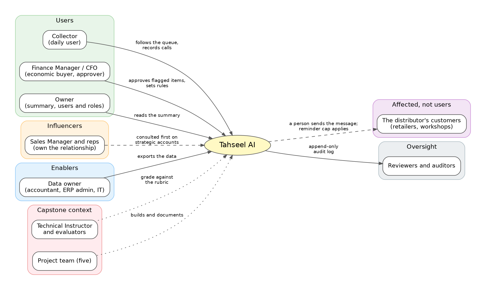

# Requirements Gathering and Stakeholder Analysis

This part identifies who is affected by Tahseel AI and what they need, then states what the system must do (functional requirements) and how well it must do it (quality requirements). It is built from the product specification (`docs/technical/Tahseel_AI_PRD.md`), the scope (`docs/foundation/Tahseel_AI_Final_Concept.md`), and the business analysis (`docs/business/Tahseel_AI_Business_Strength.md`).

**An honest note on the evidence.** We have not interviewed any distributor. Every stakeholder need below is a **hypothesis** from desk research, to be tested in the validation plan. The requirements are therefore what we decided to build, not findings from users.

## 1. Stakeholder analysis

### 1.1 Stakeholder map

### 1.2 Stakeholders, needs, and concerns

Influence and interest are our estimates (Hypothesis).

| Stakeholder | Relation to the product | Needs | Concerns | Influence | Interest |
|---|---|---|---|---|---|
| **Finance Manager / CFO** | Economic buyer and champion; the Finance Manager role | Lower days beyond terms; a lower overdue share; cash visibility for 7 and 30 days; control over the collection team | Cannot verify what the AI says; losing control; wrong numbers | High | High |
| **Owner** | Beneficiary (also the buyer in smaller firms); the Owner role | An understandable summary; to know which accounts threaten cash | Reports that arrive late or lack explanation | High | Medium |
| **Collector** (collection officer) | Daily user; the Collector role | To know who to contact first; history and the relevant policy in one place; professional messages quickly | Scattered information; more work instead of less | Medium | High |
| **Sales Manager and reps** | Influencers, not product users in the MVP | Protection of relationships with key customers | A collection call that damages a key account | Medium to high (can block) | Medium |
| **Data owner** (accountant, ERP admin, IT) | Enabler | A simple export of data without disrupting the ERP | Messy exports; risk to the live system | Medium | Low to medium |
| **The distributor's customers** (retailers, workshops) | Affected, not users | Good supply and fair terms | Pressure at a bad moment; too many reminders | Low (indirect) | Low |
| **Reviewers and auditors** | Read the audit log | Evidence of who approved what | Untraceable decisions | Low | Medium |
| **Technical Instructor and evaluators** (capstone) | Judge the project against the rubric | Architecture, UI, RAG and memory, code quality, presentation, real-world value, collaboration | Unsupported claims; a demo that does not work | High (for the grade) | High |
| **Project team** (five) | Builds and documents | A clear scope and ownership | Scope growth; unclear roles | High | High |

### 1.3 From needs to requirements

| Stakeholder need | Requirements that answer it |
|---|---|
| Know who to chase first, and why | FR-06, FR-07, FR-08, FR-31 |
| Trust the numbers | FR-04, FR-05, FR-19, FR-21, NFR-04, NFR-06 |
| Trust the policy statements | FR-10, FR-11, FR-12 |
| Stay in control of what is sent | FR-23, FR-25, FR-26, FR-27, NFR-05 |
| Do not repeat work or forget promises | FR-14, FR-15, FR-16, FR-17 |
| Protect key relationships | FR-09, FR-28, FR-29 |
| See cash and risk at a glance | FR-03, FR-05, FR-30, FR-31 |
| Start from the files they already have | FR-01, FR-02 |
| Keep data safe and separate | FR-34, FR-35, NFR-01, NFR-02, NFR-03 |
| Use it in Arabic | FR-23, FR-32, NFR-10 |
| Show evidence of who approved what | FR-27, NFR-05 |

## 2. User stories

From the specification, section 9, with the additions made by later decisions.

**Finance Manager:** see total outstanding and overdue receivables; see high-risk customers; see expected cash; understand why a customer is high risk; approve flagged recommendations; confirm policy rules and set tenant settings.

**Collector:** see a prioritized Collection Queue; see customer history before calling; see the recommended next action; generate a message draft; record the result of a call; record a promise to pay; mark an invoice as disputed.

**Owner:** know whether collection is improving; know which accounts threaten cash flow; get an understandable summary; manage users and roles.

## 3. Functional requirements

**Tiers** (Decision Log, D29): **Core** = Must (the demo cannot run without it; never cut), **Should** = Should (built after the core slice, in the cut order), **Delivery** = scheduled after the core slice works. **Capability** refers to `Final_Concept`, section 3. **Test** refers to the acceptance criteria in the PRD, section 30.

### Import and receivables

| ID | Requirement | Tier | Capability | Test |
|---|---|---|---|---|
| FR-01 | The user can upload a CSV or Excel file. The system proposes a column mapping from the headers and masked sample rows, the user confirms it, the system validates the records, and a preview is shown before anything is imported | Core | C1 | AC-001 |
| FR-02 | The import creates or updates customers and invoices and records payments, including partial payments. Duplicate invoice numbers and missing due dates are reported with fix-or-skip choices | Core | C1 | AC-001 |
| FR-03 | After the first upload the system shows a Receivables Health Report: aging, risk distribution, the top 20 accounts to chase, and expected cash | Should | S3 | Demo checklist |
| FR-04 | The system computes outstanding amounts, days overdue, and aging per invoice and per customer. Overdue is computed from the due date and is never stored. Payments are the source of truth for what has been paid | Core | C2 | AC-002 |
| FR-05 | The system computes portfolio KPIs: totals, the overdue ratio, average days beyond terms, and DSO | Core | C2 | AC-002 |

### Risk, priority, and the queue

| ID | Requirement | Tier | Capability | Test |
|---|---|---|---|---|
| FR-06 | Every customer has a risk score from 0 to 100, built from payment behavior with default weights (days overdue 30, historical delay 25, broken promises 25, recent behavior 20). The score lists each factor and its points, and the points add up to the score | Core | C3 | AC-003, AC-010 |
| FR-07 | Every customer has a priority score = risk x overdue exposure x urgency, scaled so the top account is 100. The three factors are shown | Core | C4 | AC-003 |
| FR-08 | The Collection Queue ranks customers with overdue, non-disputed exposure. Each row shows a suggested action computed by rules, without an LLM | Core | C4 | Demo checklist |
| FR-09 | For a strategic customer, the suggested action and the recommendation are to talk to the sales rep first | Should | S2 | Demo checklist |

### Policy

| ID | Requirement | Tier | Capability | Test |
|---|---|---|---|---|
| FR-10 | Users can upload policy documents. Retrieval returns passages with the document and section as a citation, and the tenant filter is applied inside the query | Core | C5 | AC-004, AC-007 |
| FR-11 | When no relevant policy is found the system says so, and when policies conflict it flags the case for human review. It never invents policy | Core | C5 | AC-004 |
| FR-12 | Structured policy rules (thresholds, grace periods, escalation triggers) are evaluated by code and shown with their source document and section. A Finance Manager confirms them. They are entered manually or loaded by a seed script | Should | S5 | AC-011 |
| FR-13 | Weights, caps, grace periods, escalation triggers, the reminder cap, and tone defaults are tenant settings, not code. Changes are audited | Should | S6 | AC-010, AC-011 |

### Memory

| ID | Requirement | Tier | Capability | Test |
|---|---|---|---|---|
| FR-14 | A Collector can record a note, a call result, and a promise to pay. Each entry carries author, timestamp, and source | Core | C7 | AC-009 |
| FR-15 | The status of a promise (pending, kept, broken) is derived by rule from payments. It feeds the risk score and the urgency | Core | C6 | AC-009 |
| FR-16 | The agent reads customer memory and cites it. The interface shows which memories were used | Core | C6 | AC-009 |
| FR-17 | The agent keeps the conversation context so follow-up questions work. Conversation memory is never a source of facts, and nothing moves into customer memory unless a person saves it | Core | C6 | AC-009 |
| FR-18 | A Finance Manager or Owner can edit or delete a memory entry. A deletion is a soft delete and is written to the audit log | Core | C6 | AC-006 |

### Agent

| ID | Requirement | Tier | Capability | Test |
|---|---|---|---|---|
| FR-19 | The agent answers questions about a customer by calling tools. Every number in an answer comes from a tool result, and a post-check confirms it | Core | C8 | Agent eval |
| FR-20 | The agent recommends a next action with reasons and citations. A new recommendation starts as pending | Core | C8 | AC-004, AC-005 |
| FR-21 | Every agent run records the model, the tools used, token counts, cost, and latency | Core | C8 | Agent eval |
| FR-22 | Retrieved text, notes, and uploaded documents are treated as data. No tool runs because a document says so | Core | C8 | Safety tests |

### Drafts, approval, and audit

| ID | Requirement | Tier | Capability | Test |
|---|---|---|---|---|
| FR-23 | The system generates message drafts in Arabic with tone options: formal, friendly, and firm. The default tone follows the customer tier | Core | C9 | Demo checklist |
| FR-24 | A rule-based check flags drafts that contain legal threats or forbidden phrases | Should | S7 | Safety tests |
| FR-25 | A user can approve, edit, or reject a recommendation. The original and edited draft text are stored with the reason. The API rejects any execution of a recommendation that is not approved | Core | C10 | AC-005 |
| FR-26 | A recommendation flagged by a policy rule needs a Finance Manager or Owner. A Collector can send it for manager review | Core | C10, C13 | AC-014 |
| FR-27 | A task is created only from an approved recommendation. Every recommendation (including ones that are never approved), approval, edit, rejection, and tool call is written to an append-only audit log | Core | C11 | AC-006 |

### Guardrails and forecast

| ID | Requirement | Tier | Capability | Test |
|---|---|---|---|---|
| FR-28 | A person can set an invoice to disputed. It leaves the ranked queue, appears in a Disputed list, follow-up pauses, and the manager is alerted. Only a manager role can clear the status | Should | S7 | AC-012 |
| FR-29 | A configurable cap limits reminders per customer per period. Beyond the cap, a draft needs a manager override | Should | S7 | AC-013 |
| FR-30 | The system shows expected cash for 7 and 30 days with a low, expected, and high range and a confidence label. It never presents the figure as guaranteed | Should | S1 | AC-008 |

### Interface, access, and delivery

| ID | Requirement | Tier | Capability | Test |
|---|---|---|---|---|
| FR-31 | The interface has the Executive dashboard, the Collection Queue, and the Customer Profile with the AI panel, plus the import screen | Core | C12 | Demo checklist |
| FR-32 | The interface works fully in Arabic (right to left) and in English, with a language toggle. All text comes from translation dictionaries | Should | S4 | Demo checklist |
| FR-33 | The AI panel shows designed states for "no relevant policy", "policies conflict", "invoice disputed", and "reminder cap reached" | Should | S5, S7 | AC-004, AC-012, AC-013 |
| FR-34 | Every record belongs to a tenant. A tenant cannot read another tenant's data, including through vector search | Core | C13 | AC-007 |
| FR-35 | There are three roles (Owner, Finance Manager, Collector), enforced on the server. A Collector sees only assigned customers. Only the Owner manages users and roles | Core | C13 | AC-014 |
| FR-36 | A basic evaluation (about 15 agent cases, about 10 retrieval queries, about 5 safety tests) and the comparison of an LLM given the raw file against the tool-grounded system are run, and the real results are reported | Core | C14 | Evaluation report |
| FR-37 | The system runs with Docker Compose, environment-based configuration, migrations, a seed script, a health-check endpoint, and CI that runs lint and tests. A public HTTPS deployment follows once the core slice works | Delivery | P1 | CI |

## 4. Quality requirements

The notice asks for quality requirements such as performance, security, and ease of use. Items marked **target** are goals to measure; they are not results.

| ID | Category | Requirement | How we verify it | Tier |
|---|---|---|---|---|
| NFR-01 | Security | Tenant isolation and server-side role checks. A cross-tenant test returns nothing; a Collector cannot reach unassigned customers | Automated tests (AC-007, AC-014) | Core |
| NFR-02 | Security | TLS in transit; encryption at rest as a deployment setting; hashed passwords; secrets only in environment variables; a least-privilege database user | Deployment checklist; secret scan in CI | Core / Delivery |
| NFR-03 | Privacy | Minimal personal data in prompts. Only synthetic data in the demo. Before real data is used, providers are restricted and their retention settings reviewed | Prompt review; documented procedure | Core |
| NFR-04 | Accuracy | Every number in an agent answer matches a tool result. Numeric errors are measured against an LLM-only baseline and reported | Agent eval and the ablation | Core |
| NFR-05 | Auditability | The audit log is append-only and the application role cannot update or delete it | Database grants; AC-006 | Core |
| NFR-06 | Explainability | Every score lists factors and points; every policy statement has a source or says none was found | AC-003, AC-004, AC-010 | Core |
| NFR-07 | Performance (target) | The queue and the dashboard make no LLM call. On the demo dataset the queue loads in about 2 seconds, and an agent answer arrives in about 30 seconds while showing which tool it is calling | Timed runs on the demo dataset | Should |
| NFR-08 | Reliability | LLM calls have timeouts, retries, and a fallback model. A failure shows a plain message and leaves nothing half-saved | Failure-injection test | Should |
| NFR-09 | Ease of use (target) | From the queue, a Collector reaches a draft in at most 3 clicks, and team members complete the main flow without instructions | Walkthrough with team members | Should |
| NFR-10 | Localization and accessibility | Arabic (right to left) and English; Western digits; `Intl` formats; text contrast at WCAG AA; color never the only signal; every action reachable by keyboard | Review against the UI checklist | Should |
| NFR-11 | Maintainability and code quality | Typed schemas, modules by responsibility, unit tests for the calculations, CI, a README with setup, and no secrets in the repository | CI results; code review | Core |
| NFR-12 | Configurability | Weights, thresholds, and rules are data, not code | AC-010, AC-011 | Should |
| NFR-13 | Portability | The whole system starts with Docker Compose on a clean machine | A clean-machine run | Delivery |
| NFR-14 | Cost control | No LLM call on page loads; per-run token and cost logging; a spending limit at the gateway | Run logs | Core |
| NFR-15 | Honesty | The demo is labeled as synthetic data; no claim of real customers, pilots, or measured accuracy that we do not have | Wording rules (Decision Log, D27) | Core |

## 5. Constraints and assumptions

**Constraints**
- A team of five, working to the capstone schedule, with an agreed cut order (Decision Log, section E).
- No access to real distributors. All data is synthetic.
- LLM access goes through a third-party gateway (OpenRouter).
- Documentation is in English; the product interface is in Arabic and English.
- The stack is fixed by the decisions: Next.js, FastAPI, PostgreSQL with pgvector, Docker Compose.

**Assumptions** (to validate; see the validation plan)
- Distributors can export their receivables to Excel (A1).
- Many companies have a documented credit policy, or can write one (A3).
- A meaningful share of lateness comes from late or inconsistent follow-up (A8).
- Collectors will act on suggestions that come with reasons (A5).

## 6. Out of scope for the capstone

Payments and wallets; automatic credit blocking; automatic WhatsApp or email sending; legal advice; ERP and CRM integrations (only the CSV and Excel adapter is built); a trained ML risk model; credit-limit recommendations. Later ideas are in the roadmap in `Final_Concept`, section 12.

## 7. Prioritization

| Tier | Meaning | Functional requirements |
|---|---|---:|
| Core (Must) | The demo cannot run without it. Never cut | 26 |
| Should | Built after the core slice, cut in the order in the Decision Log, section E | 10 |
| Delivery (Could) | Scheduled after the core slice works; a recorded demo is the fallback | 1 |

## 8. Validation of these requirements

The requirements reflect decisions, not user research. The plan to test the underlying assumptions is in `Business_Strength`, section 8: ten interviews with finance and collection people, Health Check pilots on anonymized data, and a pricing test. Each assumption has a test and a kill criterion. Requirements will be revised when real users contradict a hypothesis.
