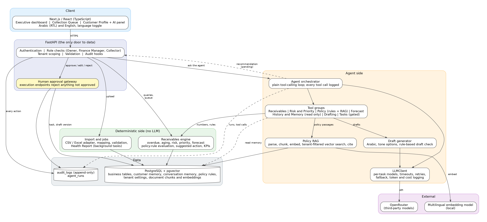
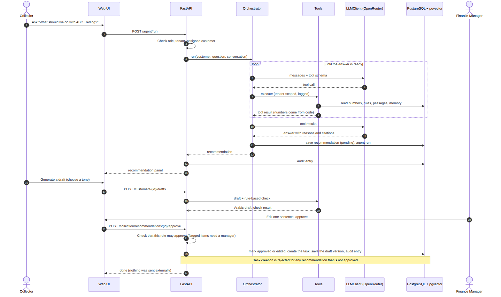
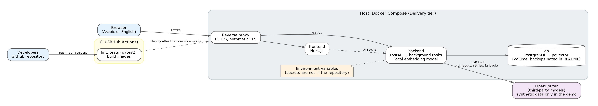

# System Architecture

This part describes how Tahseel AI is built and why. The decisions behind it are in `docs/governance/Tahseel_AI_Decision_Log.md`; the trust design is in `docs/technical/Tahseel_AI_Technical_Strength.md`.

## 1. Design goal

**Trust by construction.** A finance team will not adopt a copilot it cannot verify, so the design goal is not "the smartest AI" but **the most checkable AI**:

- every number comes from tested code, never from the language model;
- every policy statement comes from a rule with a source or from a cited passage;
- every customer memory comes from a human-authored or rule-derived event;
- every consequential action waits for a human, and that is enforced at the API.

## 2. Logical architecture

| Layer | Responsibility | Technology |
|---|---|---|
| Client | Executive dashboard, Collection Queue, Customer Profile with the AI panel; fully Arabic (RTL) and English with a language toggle | Next.js / React, TypeScript |
| API | The only way to data: authentication, role checks, tenant scoping, validation, audit hooks, and the human approval gateway | FastAPI, Pydantic |
| Deterministic side | Overdue and aging, risk, priority, forecast, policy-rule evaluation, suggested action, KPIs, and the import with its Health Report. No LLM | Python, SQLAlchemy |
| Agent side | The orchestrator (a plain tool-calling loop), its tool groups, policy RAG, the draft generator, and the `LLMClient` | Python |
| External | Third-party models through OpenRouter; a local multilingual embedding model | OpenRouter API |
| Data | Business tables, both kinds of memory, policy rules, tenant settings, document chunks with embeddings, the append-only audit log, and agent runs | PostgreSQL with pgvector |

## 3. What is a pipeline and what is an agent

| Work | Mode | Why |
|---|---|---|
| Outstanding, days overdue, risk, priority, forecast for all customers | Batch pipeline, no LLM | Deterministic, cheap, unit-testable, reproducible |
| Policy rules evaluated per customer (thresholds, grace periods, escalation triggers) | Batch pipeline, no LLM | Hard thresholds must not depend on semantic search |
| Collection Queue with a rule-based suggested action | Batch pipeline | The same input gives the same output; no LLM cost per page load |
| Explaining a customer, answering open questions, investigating | Agent (the LLM selects and combines tools) | Open-ended work needs tool selection |
| Retrieving and citing policy passages, reading customer memory, drafting a message | Agent tools | Grounding, context, and a language task |
| Creating a task | Agent tool, blocked until a human approves | Consequential |
| Writing an audit entry | Always | Traceability; it never waits for approval |
| Recording a note, a call result, or a promise | A human, through the UI and the API | The agent never writes customer memory |

The system is agentic where open-ended reasoning is needed and deterministic where correctness is needed. We do not call a fixed pipeline an agent. The queue shows a rule-based suggested action; the agent's recommendation can differ when memory or retrieved passages add context, and the interface shows both and says why.

## 4. How a request flows

The sequence shows the main use case: a Collector asks the agent about a customer, receives a recommendation with reasons and citations, generates an Arabic draft, and a Finance Manager approves it. Four properties hold at every step:

1. **Numbers come from tools.** The model quotes tool results; it does not calculate.
2. **Every tool call is tenant-scoped and logged.**
3. **The recommendation starts as pending.** Only a human decision changes it.
4. **Nothing is sent outside the system.** The approval creates a task and stores the draft; a person sends the message.

## 5. Trust boundaries and controls

| Concern | Control |
|---|---|
| One company reading another's data | `tenant_id` on every table, one tenant-scoped data layer, the tenant filter inside every vector query, and a cross-tenant test |
| Too much access inside a company | Three roles enforced on the server; a Collector sees only assigned customers |
| The AI acting on its own | An approval gateway at the API: task creation is rejected for any recommendation that is not approved |
| Wrong or invented numbers | Deterministic engine; a post-check that every number in an answer appears in a tool result; an ablation measures the difference |
| Invented policy | Structured rules with sources, cited passages, and honest "no policy found" and "policy conflict" answers |
| Prompt injection | Retrieved text, notes, and uploaded documents are data, not instructions; no tool runs because a document says so |
| Untraceable decisions | An append-only audit log; the application role cannot update or delete it |
| Data sent to third-party models | Personal data kept minimal in prompts; synthetic data only in the demo; provider retention settings reviewed and providers restricted before any real data is used |
| Data in transit and at rest | TLS in transit; encryption at rest is a deployment setting; secrets stay out of the repository |

## 6. Adaptability

Sector differences are configuration, not code. The engine runs on a canonical schema; an adapter converts a source into it (the MVP builds the CSV and Excel adapter; Odoo and ETA adapters are roadmap). Risk weights, thresholds, grace periods, escalation triggers, the reminder cap, and tone defaults live in `tenant_settings`, and structured rules live in `policy_rules`. The details are in `docs/architecture/Tahseel_AI_Adaptability_Strategy.md`.

## 7. Key architecture decisions

| ID | Decision | Reason |
|---|---|---|
| ADR-1 | A deterministic engine, separate from the LLM | Correctness and testability |
| ADR-2 | pgvector in the same PostgreSQL | One datastore; the tenant filter in the same query |
| ADR-3 | One orchestrator with grouped tools | Simpler to build, test, and defend |
| ADR-4 | Approval enforced at the API | A user-interface bug cannot bypass it |
| ADR-5 | An append-only audit log | Traceability |
| ADR-6 | A multilingual embedding model | Policies and notes may be Arabic or mixed |
| ADR-7 | Two-layer policy: rules evaluated by code, plus RAG for explanation | Thresholds must not depend on semantic search |
| ADR-8 | A canonical schema with an adapter interface, and tenant configuration | Adaptability without code changes |
| ADR-9 | LLM access through OpenRouter behind our own `LLMClient` | Switch models, compare cost, limit spend |
| ADR-10 | A plain tool-calling loop | Fewer dependencies; every call can be logged and gated |
| ADR-11 | Tenant isolation through one scoped data layer, proven by a test | Isolation that does not depend on each developer remembering a filter |
| ADR-12 | Customer memory written only by humans and rules; conversation memory is context only | Keeps the trust thesis and the follow-up feature |

## 8. Deployment

The deployment is part of the Delivery tier: it is scheduled after the core slice works, and a recorded demo is the fallback (Decision Log, D17 and D29). The basics are a Docker Compose setup with environment-based configuration, migrations, a seed script, a health-check endpoint, and CI that runs lint and tests. The public HTTPS deployment, structured logging, and the rest of the checklist come after.

## 9. Technology stack

| Layer | Choice |
|---|---|
| Frontend | Next.js / React with TypeScript |
| Backend | Python, FastAPI, Pydantic, SQLAlchemy |
| Database | PostgreSQL with pgvector |
| AI | OpenRouter behind `LLMClient`; a plain tool-calling loop; a multilingual embedding model |
| Infrastructure | Docker Compose; GitHub Actions for CI |
| Tests | pytest for overdue, risk, priority, forecast, and tenant isolation; evaluation sets for agent, RAG, recommendations, and safety; the LLM-only versus tool-grounded ablation |

## 10. Quality attributes

| Attribute | How the design addresses it |
|---|---|
| Testability | The calculations are pure code with unit tests; the AI is evaluated with fixed sets and an ablation |
| Explainability | Every score lists its factors and points; every policy statement has a source |
| Security | The controls in section 5 |
| Maintainability | Modules by responsibility; settings and rules as data; typed schemas |
| Internationalization | All strings in dictionaries from day one; logical CSS properties for RTL |
| Cost control | Page loads use no LLM; per-run token and cost logging; per-task model configuration |

## 11. Limits of what we claim

- The numbers in the demo come from synthetic data. They show that the pipeline is correct, not that predictions are accurate on real distributors.
- No performance targets are claimed or measured yet.
- Numeric hallucination is reduced by construction and measured in the ablation; it is not eliminated.
- Cross-sector adaptability is a design property. It has not been validated on real sectors.
