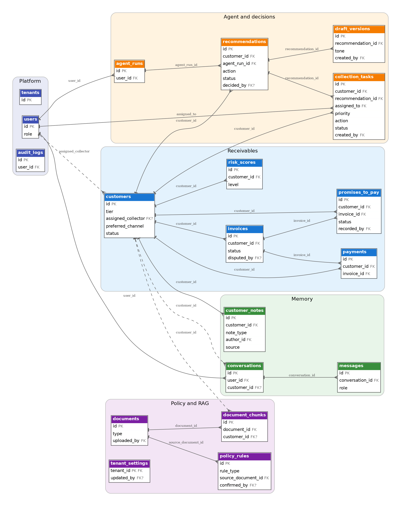

# Database Design

This part describes the PostgreSQL schema of Tahseel AI. It is generated from the data model in the product specification (`docs/technical/Tahseel_AI_PRD.md`, section 19), so the two always agree.

## 1. Design principles

- **One database, tenant-scoped.** Every table except `tenants` carries `tenant_id`. All access goes through a tenant-scoped layer, and every vector query filters by tenant inside the query. A cross-tenant test proves it.
- **Payments are the source of truth.** An invoice's `paid_amount` is a cached total that the engine recomputes from `payments`. "Overdue" is computed from the due date, never stored.
- **Humans write customer memory.** Notes, call outcomes, and promises are written by people; promise status is derived by rule. The agent has no way to write them.
- **Append-only audit.** The application's database role has no update or delete permission on `audit_logs`. Deleting a memory entry is a soft delete (`deleted_at`) and is itself audited.
- **Vectors beside the data.** Embeddings live in pgvector columns (`customer_notes.embedding`, `document_chunks.embedding`), so the tenant filter and the relational filters run in one query.
- **Configuration, not code.** Weights, thresholds, and rules live in `tenant_settings` and `policy_rules`.

## 2. Entity-relationship diagram

*Every table except `tenants` also has `tenant_id` referencing `tenants`; those edges are not drawn. The diagram shows keys and enumerated fields; the full field list is in section 4. A dashed line is an optional relationship. References from other tables to `users` (author, approver, creator) are listed in section 3 and not drawn.*

## 3. Relationships

| Child table | Field | References | Required |
|---|---|---|---|
| `users` | `tenant_id` | `tenants` | yes |
| `customers` | `tenant_id` | `tenants` | yes |
| `customers` | `assigned_collector` | `users` | no |
| `invoices` | `tenant_id` | `tenants` | yes |
| `invoices` | `customer_id` | `customers` | yes |
| `invoices` | `disputed_by` | `users` | no |
| `payments` | `tenant_id` | `tenants` | yes |
| `payments` | `customer_id` | `customers` | yes |
| `payments` | `invoice_id` | `invoices` | yes |
| `promises_to_pay` | `tenant_id` | `tenants` | yes |
| `promises_to_pay` | `customer_id` | `customers` | yes |
| `promises_to_pay` | `invoice_id` | `invoices` | yes |
| `promises_to_pay` | `recorded_by` | `users` | yes |
| `customer_notes` | `tenant_id` | `tenants` | yes |
| `customer_notes` | `customer_id` | `customers` | yes |
| `customer_notes` | `author_id` | `users` | yes |
| `recommendations` | `tenant_id` | `tenants` | yes |
| `recommendations` | `customer_id` | `customers` | yes |
| `recommendations` | `agent_run_id` | `agent_runs` | yes |
| `recommendations` | `decided_by` | `users` | no |
| `draft_versions` | `tenant_id` | `tenants` | yes |
| `draft_versions` | `recommendation_id` | `recommendations` | yes |
| `draft_versions` | `created_by` | `users` | yes |
| `collection_tasks` | `tenant_id` | `tenants` | yes |
| `collection_tasks` | `customer_id` | `customers` | yes |
| `collection_tasks` | `recommendation_id` | `recommendations` | yes |
| `collection_tasks` | `assigned_to` | `users` | yes |
| `collection_tasks` | `created_by` | `users` | yes |
| `conversations` | `tenant_id` | `tenants` | yes |
| `conversations` | `user_id` | `users` | yes |
| `conversations` | `customer_id` | `customers` | no |
| `messages` | `tenant_id` | `tenants` | yes |
| `messages` | `conversation_id` | `conversations` | yes |
| `documents` | `tenant_id` | `tenants` | yes |
| `documents` | `uploaded_by` | `users` | yes |
| `document_chunks` | `tenant_id` | `tenants` | yes |
| `document_chunks` | `document_id` | `documents` | yes |
| `document_chunks` | `customer_id` | `customers` | no |
| `policy_rules` | `tenant_id` | `tenants` | yes |
| `policy_rules` | `source_document_id` | `documents` | yes |
| `policy_rules` | `confirmed_by` | `users` | no |
| `tenant_settings` | `tenant_id` | `tenants` | yes |
| `tenant_settings` | `updated_by` | `users` | no |
| `risk_scores` | `tenant_id` | `tenants` | yes |
| `risk_scores` | `customer_id` | `customers` | yes |
| `agent_runs` | `tenant_id` | `tenants` | yes |
| `agent_runs` | `user_id` | `users` | yes |
| `audit_logs` | `tenant_id` | `tenants` | yes |
| `audit_logs` | `user_id` | `users` | yes |

## 4. Data dictionary

Types are **proposed** and are finalized in the first migration. `uuid` keys and `timestamptz` for moments are the working choices. `vector(dim)` takes its size from the embedding model chosen after the Arabic retrieval test (Decision Log, D16). Fields with a fixed set of values are stored as text with a CHECK constraint.

### tenants

One customer company on the platform. Every other table points to it.

| Field | Type | Key | Notes |
|---|---|---|---|
| `id` | uuid | PK |  |
| `name` | text |  |  |
| `industry` | text |  |  |
| `created_at` | timestamptz |  |  |

### users

People who sign in. Each has one of three roles.

| Field | Type | Key | Notes |
|---|---|---|---|
| `id` | uuid | PK |  |
| `tenant_id` | uuid | FK |  |
| `name` | text |  |  |
| `email` | text |  |  |
| `password_hash` | text |  |  |
| `role` | text |  | values: OWNER / FINANCE_MANAGER / COLLECTOR |
| `created_at` | timestamptz |  |  |

### customers

The distributor's credit customers, with tier, sales rep, assigned collector, and contact preferences.

| Field | Type | Key | Notes |
|---|---|---|---|
| `id` | uuid | PK |  |
| `tenant_id` | uuid | FK |  |
| `name` | text |  |  |
| `phone` | text |  |  |
| `email` | text |  |  |
| `credit_limit` | numeric(14,2) |  | stored as data; recommending limits is out of scope |
| `payment_terms` | text |  |  |
| `tier` | text |  | values: strategic / regular |
| `sales_rep` | text |  |  |
| `assigned_collector` | uuid | FK? | user id; makes "assigned only" enforceable |
| `preferred_channel` | text |  | values: call / whatsapp / email; set by a human |
| `contact_person` | text |  | set by a human |
| `status` | text |  | values: active / inactive |
| `created_at` | timestamptz |  |  |

### invoices

Invoices issued to customers. Overdue is computed from the due date and never stored.

| Field | Type | Key | Notes |
|---|---|---|---|
| `id` | uuid | PK |  |
| `tenant_id` | uuid | FK |  |
| `customer_id` | uuid | FK |  |
| `invoice_number` | text |  |  |
| `invoice_date` | date |  |  |
| `due_date` | date |  |  |
| `amount` | numeric(14,2) |  |  |
| `paid_amount` | numeric(14,2) |  | cache, recomputed from payments |
| `status` | text |  | values: open / paid / disputed |
| `dispute_reason` | text |  |  |
| `disputed_by` | uuid | FK? |  |
| `disputed_at` | timestamptz |  |  |
| `created_at` | timestamptz |  |  |

### payments

Payments received. The source of truth for what has been paid.

| Field | Type | Key | Notes |
|---|---|---|---|
| `id` | uuid | PK |  |
| `tenant_id` | uuid | FK |  |
| `customer_id` | uuid | FK |  |
| `invoice_id` | uuid | FK |  |
| `amount` | numeric(14,2) |  |  |
| `payment_date` | date |  |  |
| `method` | text |  |  |
| `created_at` | timestamptz |  |  |

### promises_to_pay

Promises recorded by a person. Their status is derived by rule from payments.

| Field | Type | Key | Notes |
|---|---|---|---|
| `id` | uuid | PK |  |
| `tenant_id` | uuid | FK |  |
| `customer_id` | uuid | FK |  |
| `invoice_id` | uuid | FK |  |
| `promised_amount` | numeric(14,2) |  |  |
| `promise_date` | date |  |  |
| `status` | text |  | values: pending / kept / broken |
| `recorded_by` | uuid | FK |  |
| `created_at` | timestamptz |  |  |
| `resolved_at` | timestamptz |  |  |

### customer_notes

Customer memory: notes, sales rep notes, and call outcomes, written by humans, with an embedding for recall.

| Field | Type | Key | Notes |
|---|---|---|---|
| `id` | uuid | PK |  |
| `tenant_id` | uuid | FK |  |
| `customer_id` | uuid | FK |  |
| `note_type` | text |  | values: collector / sales_rep / call_outcome |
| `text` | text |  |  |
| `embedding` | vector(dim) |  | vector; D16 |
| `author_id` | uuid | FK |  |
| `source` | text |  | values: ui / import |
| `created_at` | timestamptz |  |  |
| `deleted_at` | timestamptz |  | soft delete; see the audit log |

### recommendations

What the agent recommended and what a human decided (approved, edited, rejected).

| Field | Type | Key | Notes |
|---|---|---|---|
| `id` | uuid | PK |  |
| `tenant_id` | uuid | FK |  |
| `customer_id` | uuid | FK |  |
| `agent_run_id` | uuid | FK |  |
| `action` | text |  | values: CALL / WHATSAPP / EMAIL / WAIT / ESCALATE_TO_MANAGER / TALK_TO_SALES_REP |
| `reasons` | jsonb |  | list of reasons |
| `citations` | jsonb |  | triggered rules and retrieved passages |
| `requires_manager_review` | boolean |  |  |
| `status` | text |  | values: pending / approved / edited / rejected |
| `decided_by` | uuid | FK? |  |
| `decided_at` | timestamptz |  |  |
| `decision_reason` | text |  |  |
| `created_at` | timestamptz |  |  |

### draft_versions

The original and edited text of each message draft, with the reason and the draft-check result.

| Field | Type | Key | Notes |
|---|---|---|---|
| `id` | uuid | PK |  |
| `tenant_id` | uuid | FK |  |
| `recommendation_id` | uuid | FK |  |
| `tone` | text |  | values: formal / friendly / firm |
| `original_text` | text |  |  |
| `edited_text` | text |  |  |
| `edit_reason` | text |  |  |
| `check_result` | jsonb |  | output of the rule-based draft check |
| `created_by` | uuid | FK |  |
| `created_at` | timestamptz |  |  |

### collection_tasks

Follow-up tasks created from approved recommendations.

| Field | Type | Key | Notes |
|---|---|---|---|
| `id` | uuid | PK |  |
| `tenant_id` | uuid | FK |  |
| `customer_id` | uuid | FK |  |
| `recommendation_id` | uuid | FK |  |
| `assigned_to` | uuid | FK |  |
| `priority` | text |  | values: HIGH / MEDIUM / LOW |
| `action` | text |  | values: CALL / WHATSAPP / EMAIL / WAIT / ESCALATE_TO_MANAGER / TALK_TO_SALES_REP |
| `due_at` | timestamptz |  |  |
| `status` | text |  | values: pending / done / cancelled |
| `notes` | text |  |  |
| `created_by` | uuid | FK |  |
| `created_at` | timestamptz |  |  |

### conversations

Chat threads between a user and the agent (conversation memory).

| Field | Type | Key | Notes |
|---|---|---|---|
| `id` | uuid | PK |  |
| `tenant_id` | uuid | FK |  |
| `user_id` | uuid | FK |  |
| `customer_id` | uuid | FK? | optional |
| `created_at` | timestamptz |  |  |

### messages

Turns of a thread; an LLM-written summary is marked and never treated as fact.

| Field | Type | Key | Notes |
|---|---|---|---|
| `id` | uuid | PK |  |
| `tenant_id` | uuid | FK |  |
| `conversation_id` | uuid | FK |  |
| `role` | text |  | values: user / assistant / tool |
| `content` | text |  |  |
| `tool_calls` | jsonb |  |  |
| `is_summary` | boolean |  | true for an LLM-written running summary, labeled AI-generated |
| `created_at` | timestamptz |  |  |

### documents

Uploaded policy, contract, template, and terms documents.

| Field | Type | Key | Notes |
|---|---|---|---|
| `id` | uuid | PK |  |
| `tenant_id` | uuid | FK |  |
| `name` | text |  |  |
| `type` | text |  | values: credit_policy / collection_policy / payment_terms / template / contract / other |
| `storage_path` | text |  |  |
| `uploaded_by` | uuid | FK |  |
| `effective_date` | date |  |  |
| `created_at` | timestamptz |  |  |

### document_chunks

Searchable passages of documents with an embedding, for cited retrieval.

| Field | Type | Key | Notes |
|---|---|---|---|
| `id` | uuid | PK |  |
| `tenant_id` | uuid | FK |  |
| `document_id` | uuid | FK |  |
| `customer_id` | uuid | FK? | optional |
| `policy_type` | text |  |  |
| `section` | text |  |  |
| `page` | integer |  |  |
| `effective_date` | date |  |  |
| `text` | text |  |  |
| `embedding` | vector(dim) |  | vector |
| `created_at` | timestamptz |  |  |

### policy_rules

Structured rules evaluated by code, each with its source document and section.

| Field | Type | Key | Notes |
|---|---|---|---|
| `id` | uuid | PK |  |
| `tenant_id` | uuid | FK |  |
| `name` | text |  |  |
| `rule_type` | text |  | values: escalation / grace_period / limit / review_required |
| `condition` | jsonb |  |  |
| `outcome` | jsonb |  | for example requires_manager_review, or a suggested action |
| `source_document_id` | uuid | FK |  |
| `source_section` | text |  |  |
| `confirmed_by` | uuid | FK? |  |
| `confirmed_at` | timestamptz |  |  |
| `active` | boolean |  |  |

### tenant_settings

Per-tenant configuration: weights, caps, grace periods, triggers, reminder cap, tone defaults.

| Field | Type | Key | Notes |
|---|---|---|---|
| `tenant_id` | uuid | PK FK |  |
| `settings` | jsonb |  | validated by a typed schema |
| `updated_by` | uuid | FK? |  |
| `updated_at` | timestamptz |  |  |

### risk_scores

The latest and past risk scores with the points of every factor.

| Field | Type | Key | Notes |
|---|---|---|---|
| `id` | uuid | PK |  |
| `tenant_id` | uuid | FK |  |
| `customer_id` | uuid | FK |  |
| `score` | smallint |  |  |
| `level` | text |  | values: LOW / MEDIUM / HIGH / CRITICAL |
| `factors` | jsonb |  | factor, points, detail |
| `calculated_at` | timestamptz |  |  |

### agent_runs

One row per agent run, with model, tools used, tokens, cost, and latency.

| Field | Type | Key | Notes |
|---|---|---|---|
| `id` | uuid | PK |  |
| `tenant_id` | uuid | FK |  |
| `user_id` | uuid | FK |  |
| `run_type` | text |  |  |
| `input` | jsonb |  |  |
| `output` | jsonb |  |  |
| `tools_used` | jsonb |  |  |
| `status` | text |  |  |
| `model` | text |  |  |
| `prompt_tokens` | integer |  |  |
| `completion_tokens` | integer |  |  |
| `cost_estimate` | numeric(10,4) |  |  |
| `latency_ms` | integer |  |  |
| `created_at` | timestamptz |  |  |

### audit_logs

Append-only record of every recommendation, approval, edit, rejection, tool call, and memory change.

| Field | Type | Key | Notes |
|---|---|---|---|
| `id` | uuid | PK |  |
| `tenant_id` | uuid | FK |  |
| `user_id` | uuid | FK |  |
| `action` | text |  |  |
| `entity_type` | text |  |  |
| `entity_id` | text |  |  |
| `before` | jsonb |  |  |
| `after` | jsonb |  |  |
| `created_at` | timestamptz |  |  |

## 5. Indexes and constraints (proposed)

| Where | What | Why |
|---|---|---|
| `invoices` | unique (`tenant_id`, `invoice_number`) | The same invoice number cannot be imported twice by one tenant |
| `invoices` | index (`tenant_id`, `customer_id`, `due_date`) | Fast overdue queries per customer |
| `payments` | index (`tenant_id`, `invoice_id`) | Recompute `paid_amount` quickly |
| `customer_notes`, `document_chunks` | vector index on `embedding` plus btree on `tenant_id` | Similarity search that always filters by tenant |
| `audit_logs` | no UPDATE or DELETE grant for the application role | Append-only |
| `tenant_settings` | the risk weights total 100 (checked by the typed settings schema) | The score arithmetic stays valid |
| enumerated fields | CHECK constraint on the allowed values | Bad values are rejected by the database |

## 6. Open points

- The embedding dimension and the model are not chosen yet (D16).
- Invoice line items are not modeled; the MVP works at invoice level (see the Adaptability Strategy).
- Types, indexes, and constraints above are a design proposal and will be fixed when the first migration is written.
