# UI/UX Design

This part shows how Tahseel AI looks and behaves. The wireframes are low fidelity: they fix the layout, the content, and the behavior, not the final visual style. Every screen exists in English and in Arabic (right to left). All figures on the wireframes are **sample data for layout only; they are not results**.

## 1. Design principles

| Principle | What it means on screen |
|---|---|
| **Show the reason, not only the answer** | Every score lists its factors and points; every recommendation lists why, which policy rule or passage applies, and which memory was used |
| **The human decides** | Approve, Edit, and Reject are always visible; the screen says plainly that Tahseel never sends the message |
| **Honest "I cannot" states** | "No relevant policy found", "policies conflict", "invoice disputed", and "reminder cap reached" are designed states, not error pages |
| **One list to start the day** | The Collection Queue is the Collector's home; the executive dashboard is the manager's |
| **Fully bilingual** | Arabic (right to left) and English with a language toggle on every page; no text is hard-coded |
| **Right information for the role** | A Collector sees assigned customers; managers see everything, settings, and the audit log |

## 2. Users and their main tasks

| Role | Main tasks | Home screen |
|---|---|---|
| **Collector** | See who to chase today; open a customer; ask the agent; generate and submit a draft; record a call result and a promise; mark an invoice as disputed | Collection Queue |
| **Finance Manager** | Review flagged recommendations; approve or reject drafts; confirm policy rules; set weights and caps; import data | Executive dashboard |
| **Owner** | See the summary and cash expectations; manage users and roles | Executive dashboard |

The personas and their needs are in the Requirements part. Every need there is a hypothesis until interviews happen.

## 3. Navigation and task flow

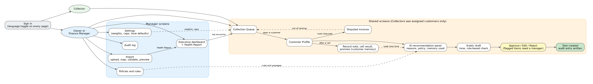

The main path follows the demo flow in the Final Concept: import, Health Report, Collection Queue, Customer Profile, the AI panel, the Arabic draft, the decision, and the task with its audit entry. Recording a call result feeds the memory that the AI panel uses the next time.

## 4. Screens

Each screen is shown in English and in Arabic. The Arabic version mirrors the layout (the navigation moves to the right) and keeps Western digits.

### 4.1 Import receivables

Capability C1 and the start of the demo. The user uploads a CSV or Excel file, the column mapping is proposed from the headers and a few masked sample rows, and the user confirms it. Validation lists problems before anything is imported, and a preview shows how the rows will look.

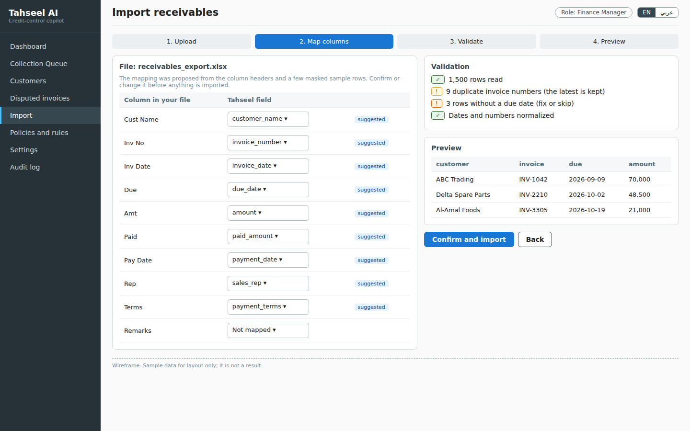

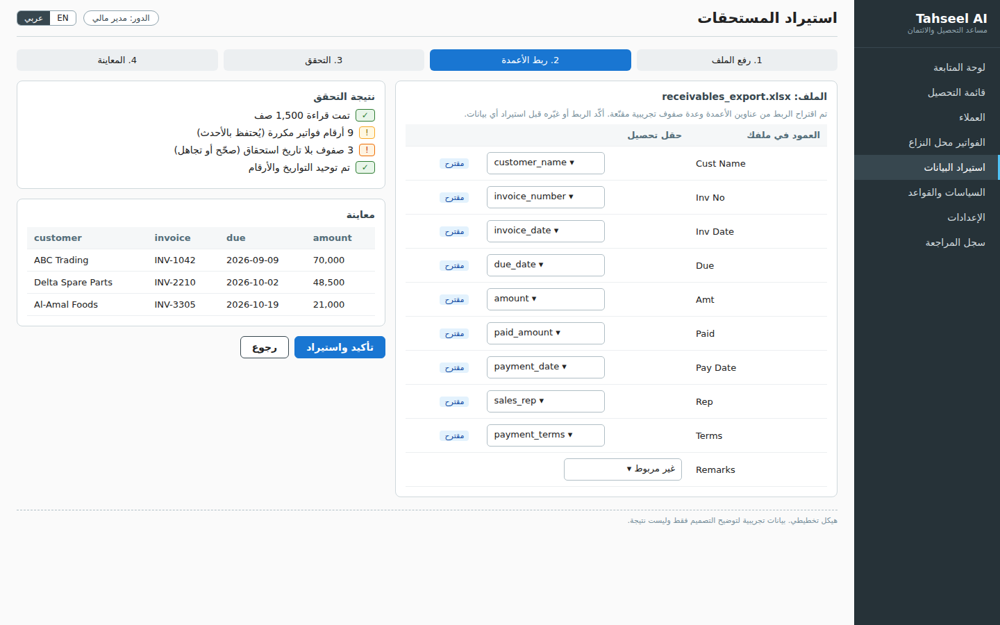

### 4.2 Executive dashboard

For the Owner and the Finance Manager (Core, with the forecast and Health Report in the Should tier). It opens with the Receivables Health Report banner after the first upload. The cards show total receivables, the overdue amount, the high-risk exposure, and the average days beyond terms with DSO as a secondary figure. The expected cash is labeled "not guaranteed" and shows a range and a confidence label.

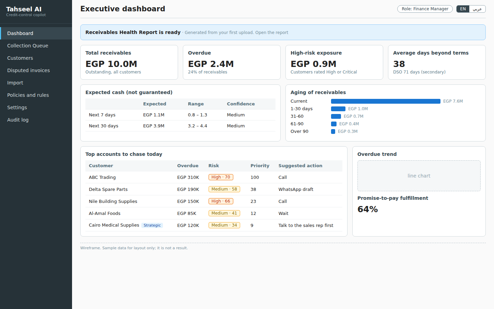

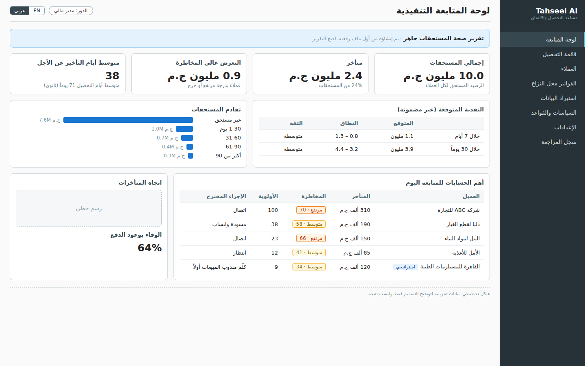

### 4.3 Collection Queue

The Collector's home screen. Customers are ranked by priority. Each row shows the overdue amount, the oldest overdue invoice, the risk score as a labeled badge, the priority, and the **suggested action computed by rules**. A tag marks items that need manager review and strategic accounts, whose suggested action is "talk to the sales rep first". Disputed invoices are listed separately and are not ranked.

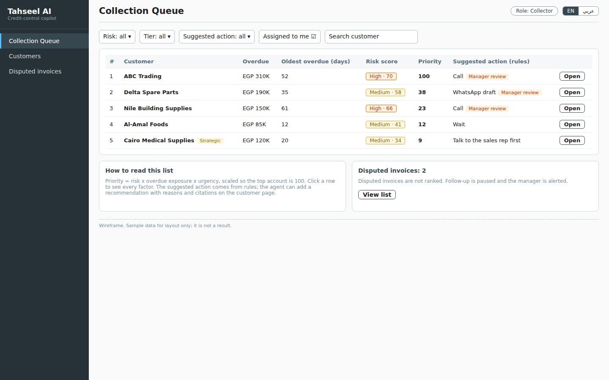

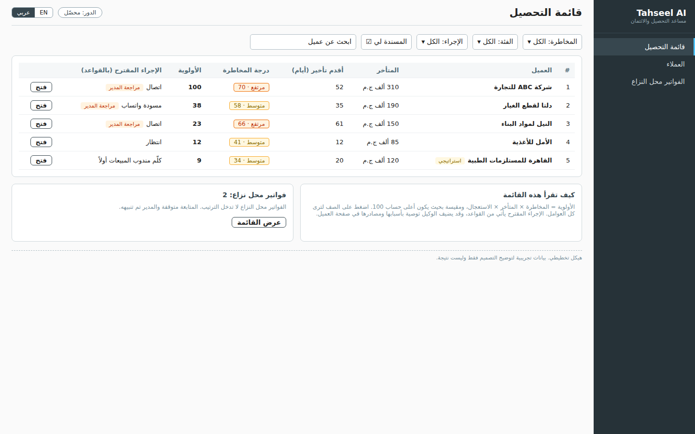

### 4.4 Customer Profile with the AI panel

The densest screen. On the left side (right in Arabic): the customer's summary, the score with every factor and its points, the overdue invoices, the notes and promises, and the form to record a call result. On the other side: the **AI recommendation panel** with the recommended action, the reasons, the policy rule and the passage that explains it, the memory that was used, the Arabic draft with tone options and the result of the rule-based draft check, and the Approve, Edit, and Reject buttons. A Collector sees "Send for manager review" in place of Approve for flagged items.

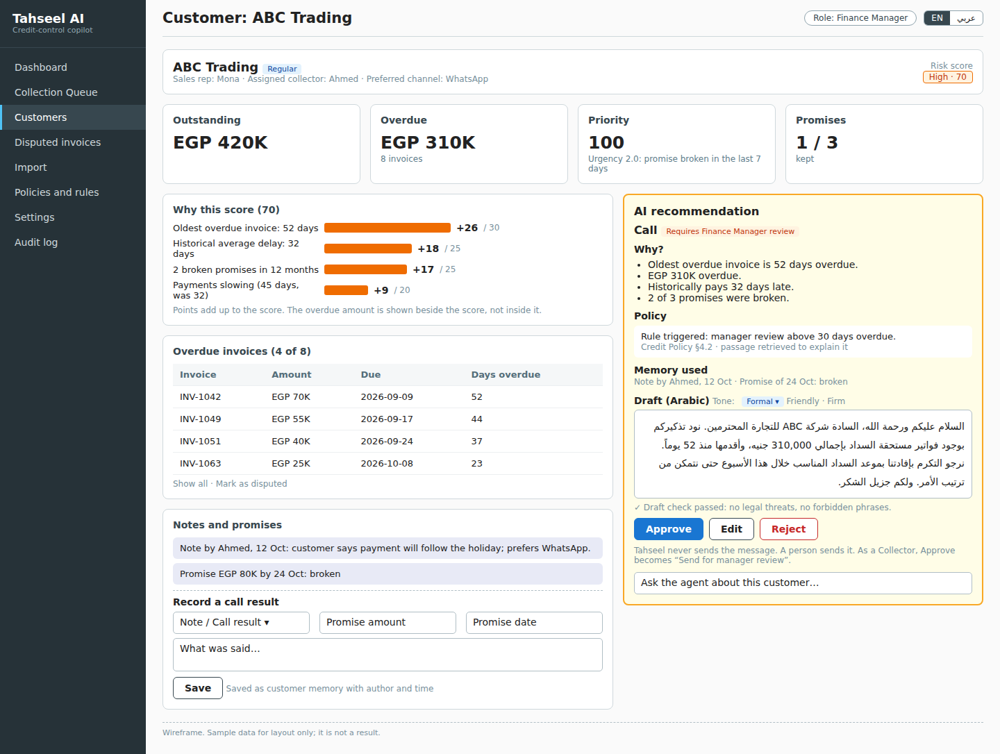

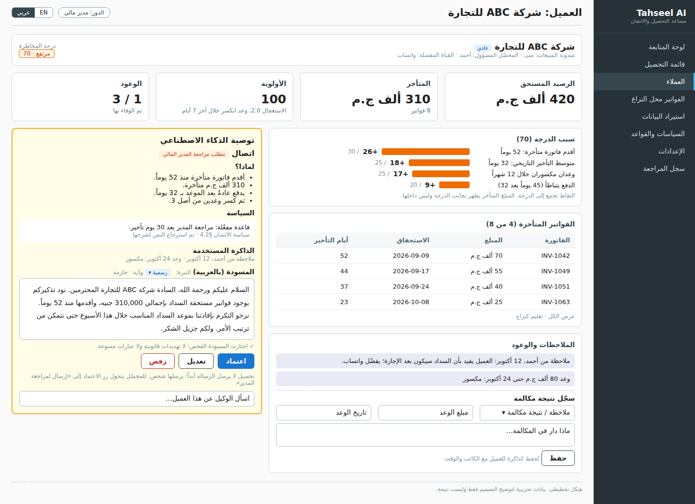

### 4.5 AI panel states

The panel is designed for the cases where the honest answer is "I cannot": no relevant policy, conflicting policies, a disputed invoice, and a reached reminder cap. These are the behaviors that make the system trustworthy, so they get their own designs.

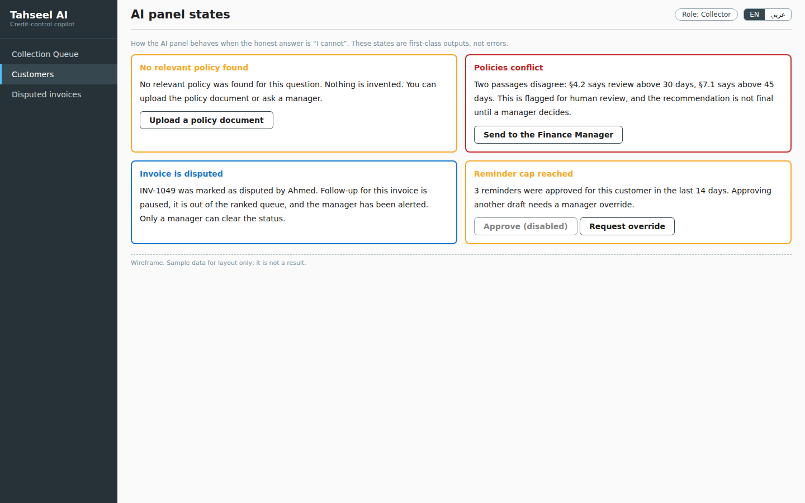

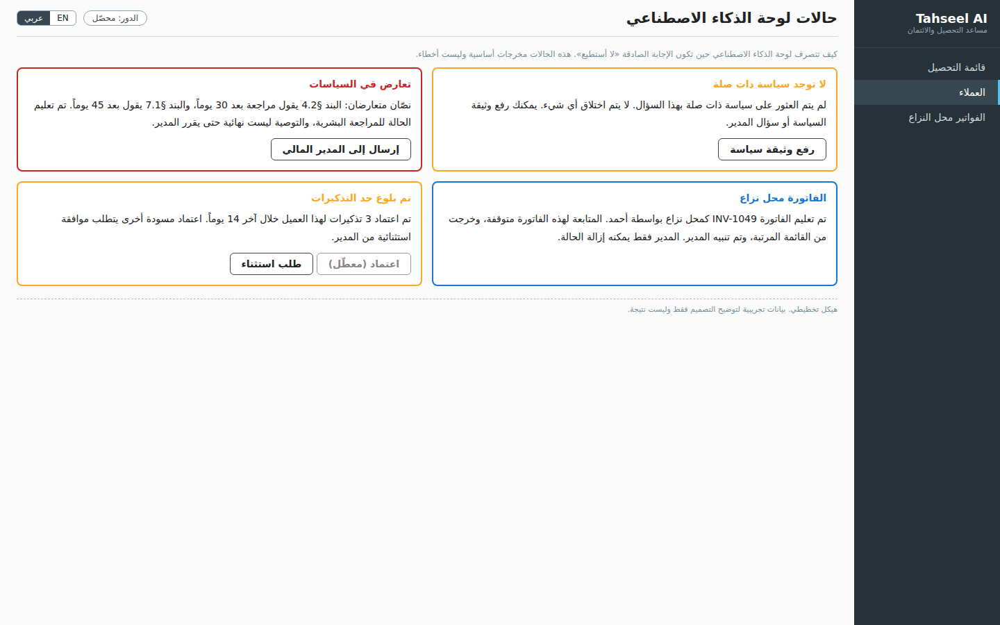

## 5. How the screens connect to the system

| Screen element | Comes from | Capability | Who sees it |
|---|---|---|---|
| Totals, aging, days beyond terms, DSO | Receivables engine (`get_portfolio_kpis`) | C2, S3 | Owner, Finance Manager |
| Expected cash with range and confidence | Forecast (`forecast_cash`) | S1 | Owner, Finance Manager |
| Risk score and factors | `calculate_risk` | C3 | All roles (Collector: assigned customers) |
| Priority and suggested action | `calculate_priority` and the suggested-action rules | C4 | All roles |
| Policy rule and cited passage | `retrieve_policy` (rules by code, passages by retrieval) | C5, S5 | All roles |
| Memory used | `get_customer_history` (customer memory, read only) | C6 | All roles |
| Record a call result and a promise | Written by a person through the API | C7 | All roles (Collector: assigned customers) |
| Arabic draft, tone, draft check | `draft_message` and the rule-based check | C9, S7 | All roles |
| Approve, Edit, Reject | The approval gateway at the API | C10 | Collector for routine drafts; a manager for flagged ones |
| Disputed status | Set by a person; the system then pauses follow-up | S7 | Set: all roles on assigned customers; cleared: managers |
| Weights, caps, tone defaults, rules | `tenant_settings`, `policy_rules` | S5, S6 | Managers |

## 6. Screen states

| State | What the user sees |
|---|---|
| Loading | A skeleton of the layout; the agent shows which tool it is calling |
| Empty queue | "No overdue accounts today", with the date of the last import |
| Import problems | Row-level warnings and errors with fix or skip choices |
| No relevant policy | The panel says so and offers to upload a policy document |
| Policies conflict | The panel shows both passages and sends the case to a manager |
| Disputed invoice | The invoice leaves the ranking; follow-up is paused; the manager is alerted |
| Reminder cap reached | Approve is disabled and a manager override can be requested |
| Not permitted | A short message names the role that can do it |
| Error | A plain message and a retry; nothing is half-saved |

## 7. Bilingual and accessibility rules

- **Right to left.** The Arabic UI mirrors the layout. The code uses CSS logical properties, so one stylesheet serves both directions. Direction-bearing icons such as arrows are mirrored; others are not.
- **Digits and formats.** Western digits by default. Amounts and dates are formatted with `Intl`, as "EGP 310,000" in English and "310,000 ج.م" in Arabic.
- **Mixed text.** Invoice numbers, customer names in Latin letters, and codes keep their own direction inside Arabic sentences.
- **No hard-coded text.** Every string comes from a translation dictionary, from the first screen built.
- **Color is never the only signal.** Risk levels show a word and a number as well as a color. Warnings carry an icon or a label.
- **Contrast and keyboard.** Text meets the WCAG AA contrast ratio, every action is reachable by keyboard, and focus is visible.
- **The draft is Arabic.** Message drafts default to Arabic in both interface languages, with tone options: formal, friendly, and firm. The default tone follows the customer tier.

## 8. Visual style (to confirm)

The wireframes are grayscale with one accent color. The final style is decided when the interface is built:

| Item | Working choice |
|---|---|
| Color | A neutral base, one primary blue, and four risk colors with labels |
| Type | A font family with good Arabic and Latin coverage, chosen after testing |
| Spacing | An 8-pixel grid |
| Layout | Desktop first (wireframes at 1440 pixels wide); tablets next; phones are not part of the MVP |

## 9. Limits of this design

- The wireframes are low fidelity and have not been tested with real users.
- The Arabic text was written for layout and needs review by native speakers on the team before release [status to confirm].
- All numbers are sample data. The demo will show values from the data generator.
- The real font and visual style are not chosen yet.
- Which Should-tier screens exist in the final build depends on the cut order in the Decision Log.
